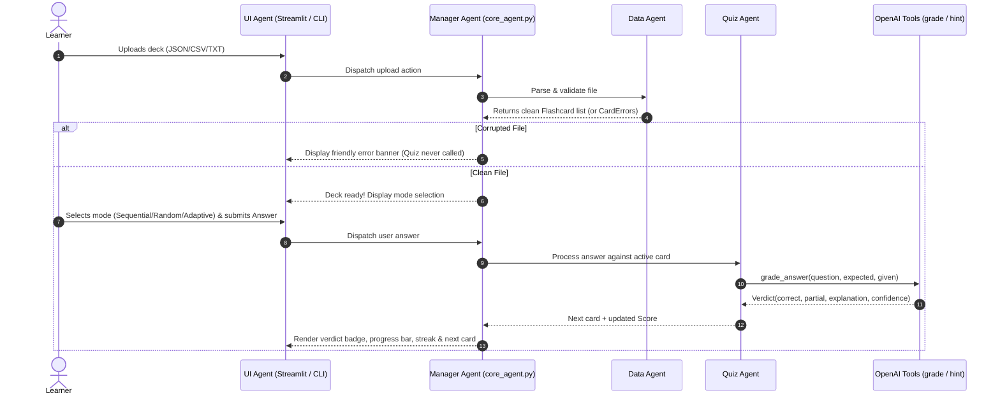

# Flashcard Quizzer Multi-Agent System — Final Master Plan

> **Source Synthesis:**
> - `MULTI_AGENT_BLUEPRINT-2.md`: Provides the enterprise multi-agent skeleton, file contracts, configuration loading, safety guardrails, observability, and test harnesses.
> - `flashcard_quizzer_multi_agent_system_design.txt`: Provides the core domain logic — a multi-agent team (Manager, Data, Quiz, UI, and QA) powering 3 quiz modes (Sequential, Random, Adaptive) with resilient file ingestion and clean separation of concerns.
>
> **Core Architectural Pillars:**
> 1. **OpenAI-First with 3-Tier Eager Validation**: The LLM provider is exclusively OpenAI (API key strictly loaded via `.env`). Validated statically (format, length, bounds) and dynamically (live API check + model probe) via `config.py --check` before any agent or UI process runs.
> 2. **Strict Pydantic Boundaries**: No bare dictionaries cross module boundaries. All configs (`BaseSettings`), agent I/O, tool calls, and trace events are strongly typed Pydantic models.
> 3. **Fault-Tolerant Data Ingestion**: Supports JSON, CSV, and alternating-line TXT/MD. Corrupted files produce structured `CardError` objects and user-friendly notifications without crashing or reaching the quiz engine.
> 4. **Adaptive Learning & Semantic Grading**: Semantic answer comparison using OpenAI with partial credit, confidence scoring, contextual hint generation, and a 2-requeue cap on missed cards before recording as a final miss.
> 5. **Dual Observability Engine**: Unified `TraceEvent` capturing latency, input/output summaries, token counts, and USD cost. Backed natively by Langfuse when credentials exist, and degrades cleanly to local JSON-lines in `logs/interactions.log` with a built-in model pricing table.

---

## 1. System Architecture & Information Flow

```mermaid
graph TD
    User([Learner / User]) <--> UI[UI Agent\nStreamlit Web & Terminal CLI]
    UI <--> Manager[Manager Agent / Core Orchestrator\nagent/core_agent.py]
    
    subgraph Specialists ["Specialized Agents (Pydantic Contracts)"]
        Manager -->|raw file stream| DataAgent[Data Agent\nagent/agents/data_agent.py]
        DataAgent -->|list[Flashcard] + list[CardError]| Manager
        Manager -->|clean Flashcards + user answers| QuizAgent[Quiz Agent\nagent/agents/quiz_agent.py]
        QuizAgent -->|Verdict + Score + next_card| Manager
    end

    subgraph Infrastructure ["Core Services & Tool Layer"]
        Config[config.py\nPydantic BaseSettings & Live Ping]
        OpenAIClient[llm/openai_client.py\nValidated Singleton Client]
        ToolReg[tools/tool_registry.py\ngrade_answer, generate_hint, track_stats]
        Safety[safety/guardrails.py\nPII & Prompt-Injection Filter]
        Observer[monitoring/langfuse_logger.py\nLangfuse or JSON-lines Cost/Trace]
        QA[QA Agent & Harness\ntests/ + evaluation/deepeval_harness.py]
    end

    Config --> OpenAIClient
    OpenAIClient --> ToolReg
    QuizAgent --> ToolReg
    Manager --> Safety
    Manager --> Observer
    ToolReg --> Observer
    QA -.->|Gates Release| Manager
```

### Runtime Turn Sequence


---

## 2. Project Specifications & Requirements

### Section 1 — Project Requirements
- **Project Identifier**: `flashcard_quizzer` (workspace: `/Users/sreepavani/workspace/work/week_19/g_proj`)
- **Domain**: Education / Self-Study & Exam Preparation
- **Primary Users**: Students, technical learners, self-studiers, and test-prep educators
- **Success Metrics**:
  - `100%` of malformed/corrupted card files produce friendly errors with zero unhandled exceptions.
  - All 3 quiz modes (`sequential`, `random`, `adaptive`) execute completely end-to-end.
  - LLM semantic answer grading matches human judgment on `>= 90%` of evaluation rubric test cases.
  - Adaptive mode re-queues missed cards exactly up to 2 times, then records a final miss without infinite loops.
  - Startup initialization (config check, live LLM access probe, UI ready) completes in `< 15 seconds`.
- **System Constraints**:
  - Exclusively OpenAI (API key loaded strictly from `.env` — never hardcoded, never logged in plaintext).
  - Startup gate halts application execution with diagnostic remediation steps if API connection fails.
  - In-memory execution: zero external database dependencies (FAISS vector store is in-memory only).
  - All inter-module communication is enforced with Pydantic schemas.

---

## 3. Agent Team & Strong Pydantic Contracts

### Common Pydantic Schemas (`agent/schemas.py`)

```python
from pydantic import BaseModel, Field
from typing import Optional, List

class Flashcard(BaseModel):
    id: str
    question: str = Field(..., min_length=1)
    answer: str = Field(..., min_length=1)
    tags: List[str] = Field(default_factory=list)
    difficulty: Optional[str] = "medium"

class CardError(BaseModel):
    line_no: Optional[int] = None
    raw_text: Optional[str] = None
    reason: str

class Verdict(BaseModel):
    correct: bool
    partial: bool = False
    explanation: str
    confidence: float = Field(ge=0.0, le=1.0)
    needs_review: bool = False

class Hint(BaseModel):
    card_id: str
    attempt: int
    hint_text: str

class Score(BaseModel):
    total_cards: int
    answered: int
    correct: int
    accuracy: float
    streak: int
    missed_cards: List[Flashcard] = Field(default_factory=list)

class TraceEvent(BaseModel):
    trace_id: str
    agent: str
    tool: Optional[str] = None
    input_summary: str
    output_summary: str
    latency_ms: float
    tokens_in: Optional[int] = None
    tokens_out: Optional[int] = None
    cost_usd: Optional[float] = None
    error: Optional[str] = None
```

### Agent Specifications

| Agent | Module | Role | Inputs | Outputs | Handoff & Failure Policy |
| :--- | :--- | :--- | :--- | :--- | :--- |
| **Manager Agent** | `agent/core_agent.py` | Pipeline orchestrator, safety check, request routing | `action: str`, `state: dict` | `response: str`, `next_step: str`, `trace_id: str` | Routes to Data or Quiz; on unhandled failure returns friendly fallback banner |
| **Data Agent** | `agent/agents/data_agent.py` | Ingests JSON/CSV/TXT/MD; cleans data, detects corruption | `file_source: str \| bytes`, `format: Optional[str]` | `cards: list[Flashcard]`, `errors: list[CardError]` | Returns empty card list + populated `errors`; quiz engine is never called on error |
| **Quiz Agent** | `agent/agents/quiz_agent.py` | Manages quiz state (3 modes), answer grading, hints | `cards: list[Flashcard]`, `mode: str`, `user_answer: str` | `verdict: Verdict`, `score: Score`, `next_card: Optional[Flashcard]` | If LLM grading fails, retries once then degrades to exact keyword match; flags card |
| **UI Agent** | `ui/app.py` & `ui/cli.py` | Dual interface: Streamlit web dashboard + terminal CLI | User clicks, uploads, typed answers | Rendered visual/CLI views | Displays progress, flip cards, toasts; no business or scoring logic inside UI |
| **QA Agent** | `agent/agents/qa_agent.py` | Validates modules, runs unit tests and DeepEval rubric | `target_suite: str` | `status: PASS \| FAIL`, `report: dict` | Gating role: project is not marked complete until all QA gates pass |

---

## 4. Tools & Observability Architecture

### 1. Tool Registry (`tools/tool_registry.py`)
- `load_flashcard_file`: Multi-format parsing (JSON objects/arrays, CSV rows, and alternating-line TXT/MD where line 1 = question, line 2 = answer, separated by blank lines).
- `grade_answer`: Semantically evaluates learner's answer against target answer via OpenAI (`gpt-4o-mini`, temperature 0.3).
- `generate_hint`: Generates a progressive hint without revealing the answer (attempt 1: brief nudge; attempt 2: conceptual context).
- `track_stats`: Persists session metrics and missed card IDs into `data/stats/` as structured JSON.
- `log_trace`: Dispatches `TraceEvent` objects to Langfuse or local logs.

### 2. Observability & Cost Tracking (`monitoring/langfuse_logger.py`)
- **Native Langfuse Mode**: When `LANGFUSE_PUBLIC_KEY` is present, logs agent steps as *spans* and OpenAI calls as *generations*, computing cost automatically.
- **Degraded Local Fallback**: When Langfuse keys are absent, appends JSON lines to `logs/interactions.log`. Token counts are captured from OpenAI API response headers/usage objects, and USD cost is calculated using a local pricing table:
  - `gpt-4o-mini`: \$0.150 per 1M input tokens, \$0.600 per 1M output tokens.
  - `text-embedding-3-small`: \$0.020 per 1M tokens.

---

## 5. Configuration & 3-Tier OpenAI Validation Engine

### Validation Workflow

```
[Application Startup]
         │
         ▼
[Tier 1: Static Pydantic Validation]
  ├── Validates .env exists
  ├── Validates OPENAI_API_KEY regex (^sk-[A-Za-z0-9-_]{20,}$)
  └── Validates temperature (0.0-2.0) and max_tokens (1-4096)
         │
         ▼ (Pass)
[Tier 2: Live Network & Model Accessibility Probe]
  ├── Calls client.models.list() (Proves auth & network connectivity)
  └── Runs a 5-token ping completion on OPENAI_MODEL (Proves quota & chat entitlement)
         │
         ▼ (Pass)
[Tier 3: Startup Application Gate]
  ├── CLI: Displays clean green [PASS] status table
  └── Streamlit: Caches verified client; blocks UI on error with actionable troubleshooting steps
```

### CLI Diagnostic Utility
Running:
```bash
python config.py --check
```
Outputs a verified status report:
```
============================================================
              OPENAI & CONFIGURATION HEALTH CHECK           
============================================================
[✓] Configuration File (.env)             : LOADED
[✓] OpenAI API Key Format                 : VALID (sk-...d8f2)
[✓] OpenAI API Connectivity               : AUTHENTICATED
[✓] Target Model (gpt-4o-mini) Access     : OPERATIONAL (Latency: 284ms)
[✓] Observability Backend                 : LOCAL FALLBACK (logs/interactions.log)
------------------------------------------------------------
Status: ALL CHECKS PASSED — Ready to run.
============================================================
```

---

## 6. Complete Repository Structure

```
g_proj/
├── PLAN.md                           # Master Architecture Plan (This Document)
├── README.md                         # Quickstart, setup, and usage documentation
├── requirements.txt                  # Python dependencies
├── .env.example                      # Environment configuration template
├── .env                              # Local active credentials (git-ignored)
├── .gitignore                        # Git exclusion rules
├── config.py                         # Pydantic BaseSettings + 3-tier validation logic
│
├── agent/
│   ├── __init__.py
│   ├── core_agent.py                 # Manager Agent (MultiAgentOrchestrator)
│   ├── prompts.py                    # Formatted system prompts for grading & hints
│   ├── memory.py                     # SessionMemory & LongTermMemory
│   ├── schemas.py                    # Pydantic data contracts (Flashcard, Verdict, etc.)
│   └── agents/
│       ├── __init__.py
│       ├── data_agent.py             # File loader & validator
│       ├── quiz_agent.py             # 3 quiz modes, scoring & adaptive queue
│       └── qa_agent.py               # QA evaluation agent
│
├── llm/
│   ├── __init__.py
│   └── openai_client.py              # Singleton OpenAI client reading solely from config
│
├── tools/
│   ├── __init__.py
│   ├── tool_registry.py              # Tool registry & dispatcher
│   └── implementations/
│       ├── __init__.py
│       ├── load_flashcard_file.py    # Multi-format deck parser
│       ├── grade_answer.py           # OpenAI semantic grading
│       ├── generate_hint.py          # OpenAI progressive hint generator
│       ├── track_stats.py            # Session statistics serializer
│       └── log_trace.py              # Observability logger
│
├── safety/
│   ├── __init__.py
│   └── guardrails.py                 # PII detection & prompt-injection filters
│
├── monitoring/
│   ├── __init__.py
│   └── langfuse_logger.py            # Langfuse & structured file fallback logger
│
├── policy_rlhf/
│   ├── __init__.py
│   ├── policy_checker.py             # Validates actions against policy.json
│   └── feedback_collector.py         # Captures user thumbs up/down
│
├── evaluation/
│   ├── __init__.py
│   ├── deepeval_harness.py           # Evaluation runner for grading accuracy
│   └── deepeval_metrics.py           # Semantic correctness metrics
│
├── data/
│   ├── sample_decks/                 # Bundled decks (Python, System Design, ML)
│   │   ├── python_basics.json
│   │   ├── system_design.csv
│   │   └── data_structures.txt
│   ├── policy/
│   │   └── policy.json               # Content & safety rules
│   ├── feedback/
│   │   └── feedback_store.json       # User feedback log
│   ├── stats/                        # Saved quiz sessions
│   └── evaluation/
│       └── eval_rubric.json          # Benchmark Q&A test cases
│
├── fixtures/                         # Test fixtures (bad JSON, malformed TXT, empty)
│   ├── valid_deck.json
│   ├── corrupted_syntax.json
│   ├── missing_fields.json
│   └── alternating_qa.txt
│
├── ui/
│   ├── __init__.py
│   ├── app.py                        # Streamlit web interface entrypoint
│   ├── cli.py                        # Terminal CLI entrypoint
│   ├── components.py                 # Flashcard renderers, scoreboards, widgets
│   └── state.py                      # Streamlit session state management
│
├── knowledge/                        # FAISS in-memory retrieval (Step 8)
│   ├── raw/
│   ├── processed/
│   └── faiss_index/
│
├── docs/
│   ├── problem_framing.md
│   ├── agent_design.md
│   ├── evaluation_report.md
│   └── engineering_decisions.md
│
├── logs/
│   ├── interactions.log
│   └── errors.log
│
└── tests/
    ├── test_config.py                # Config & LLM access validation tests
    ├── test_data_agent.py            # Good and corrupted file parsing tests
    ├── test_quiz_agent.py            # Sequential, Random, and Adaptive tests
    └── test_integration.py           # Full turn pipeline test
```

---

## 7. Step-by-Step Implementation Roadmap & Completion Gates

| Step | Phase | Key Deliverables | Completion Gate (How we prove it works) |
| :---: | :--- | :--- | :--- |
| **0** | **Environment & Dependencies** | `requirements.txt`, `.env.example`, `.env`, `.gitignore` | Virtual environment active; dependencies installed without errors |
| **1** | **Master Plan Alignment** | Finalized `PLAN.md` & project artifact | User review and approval ✅ |
| **2** | **Config, Schemas & LLM Validation** | `config.py` (Pydantic `BaseSettings`), `agent/schemas.py`, `llm/openai_client.py` | `python config.py --check` succeeds with active OpenAI connection; `pytest tests/test_config.py` passes |
| **3** | **Data Agent & Fixtures** | `tools/implementations/load_flashcard_file.py`, `agent/agents/data_agent.py`, `fixtures/` | `pytest tests/test_data_agent.py` passes on JSON, CSV, TXT, and corrupted files (zero unhandled exceptions) |
| **4** | **Quiz Agent & OpenAI Tools** | `agent/agents/quiz_agent.py`, `grade_answer.py`, `generate_hint.py`, `track_stats.py` | `pytest tests/test_quiz_agent.py` passes (Sequential, Random, Adaptive with 2-requeue cap, score math) |
| **5** | **Manager Agent & Guardrails** | `agent/core_agent.py`, `safety/guardrails.py`, `monitoring/langfuse_logger.py`, `policy_rlhf/` | Bad upload scenario passes: friendly error returned, Quiz Agent is never invoked; trace events logged |
| **6** | **Dual UI: CLI & Streamlit** | `ui/cli.py`, `ui/app.py`, `ui/components.py`, `ui/state.py` | Terminal CLI runs a full quiz; `streamlit run ui/app.py` loads decks, flips cards, streams AI grading |
| **7** | **QA Agent & DeepEval Harness** | `tests/test_integration.py`, `evaluation/deepeval_harness.py`, `eval_rubric.json` | Full test suite passes; grading accuracy `>= 90%`; QA Agent reports `PASS` |
| **8** | **In-Memory FAISS (Optional)** | `tool_retrieval/` pipeline, indexing sample study notes | Semantic search across study notes returns relevant context chunks |
| **9** | **Docs & Docker Deployment** | `README.md`, `docs/`, `deployment/Dockerfile`, `docker-compose.yml` | Container builds and runs successfully |

---

## 8. Immediate Next Action
With this unified plan approved, we proceed immediately to **Step 0 & Step 2**:
1. Create `requirements.txt` and `.env.example`.
2. Implement `config.py` (Pydantic `BaseSettings` + static/live LLM validation) and `agent/schemas.py`.
3. Run `python config.py --check` to verify your OpenAI API connection.
